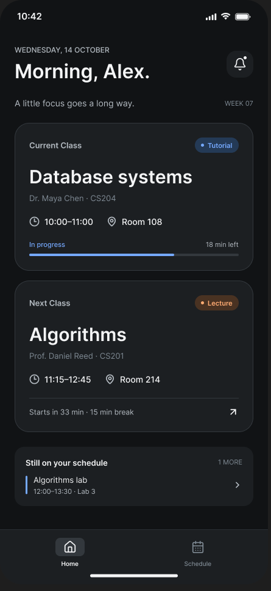
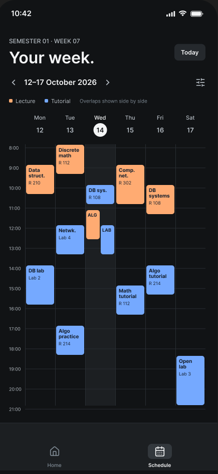
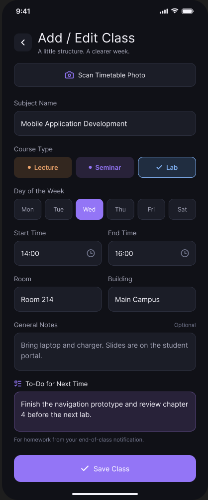
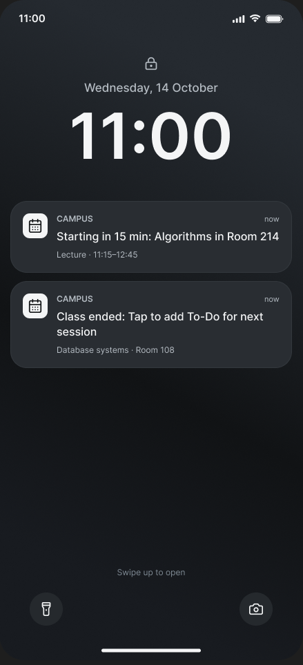

# DAM_temp_SimeonFERARD

# Smart Timetable

## 1. Short Description
"Smart Timetable" is a personal digital assistant designed for university students who want to organize their weekly classes in one simple place without dealing with complicated paper schedules or messy files. The application features a clean, dark-themed home screen that immediately shows the student's current and next class, along with a full weekly calendar view. To help students stay on track, the app sends automatic reminders 15 minutes before a class starts (showing the room and building) and another notification 5 minutes before the class ends. Tapping this end-of-class notification opens a simple text box where the student can quickly write down homework or tasks, which will automatically appear in the details of the next session for that specific subject. Built for everyday convenience, the app requires no technical knowledge and works reliably even inside university buildings with no internet connection.

## 2. Domain Details
The main entity persisted in the application is a **ClassSession** (representing a scheduled university course). Each "ClassSession" contains the following 8 fields:

* **Subject Name:** The title of the university course (e.g., *Mobile Application Development*, *Advanced Algorithms*).
* **Day of the Week:** The day when the class takes place (e.g., *Monday*, *Tuesday*).
* **Start & End Time:** The scheduled time slot for the class (e.g., *14:00 - 16:00*).
* **Room:** The specific classroom or laboratory number (e.g., *Room 214*, *C310*).
* **Building:** The name or location of the university building to help the student navigate the campus.
* **Course Type:** The format of the teaching session, chosen from three categories: *Lecture*, *Seminar*, or *Lab* (each displayed with a distinct color code).
* **General Notes:** Any permanent instructions or details about the course (e.g., *"Bring personal laptop"*, *"Attendance is mandatory"*).
* **To-Do for Next Time:** Homework, reading assignments, or preparation tasks written by the student at the end of the previous session, displayed directly in the details of the upcoming session.

*(Future Bonus Feature: A **Schedule Photo** import tool using the device's camera or a screenshot to automatically scan, translate, and convert a timetable into "ClassSession" entries).*

## 3. CRUD Operations
In the context of the "ClassSession" entity, the application supports the following operations:

* **Create:** The user can manually add a new class session to their timetable by filling out a dedicated form with the subject name, day, time slot, room, building, course type, and optional notes.
* **Read:** The user can view their saved classes in two ways:
  * **Daily Home View:** Displays stacked cards highlighting the "Current Class" and the "Next Class", including the room, building, and any "To-Do" notes written during the previous week.
  * **Weekly Schedule View:** Displays a full weekly grid (Monday to Saturday, 08:00 to 21:00) with color-coded blocks for each class Tapping a block opens the full details of that session.
* **Update:** The user can edit any existing class session (for instance, if a room changes or the professor reschedules the time). Additionally, tapping the notification received 5 minutes before the end of a class opens a quick-edit form that updates the **"To-Do for Next Time"** field for the next occurrence of that subject.
* **Delete:** If a course is dropped, canceled, or entered by mistake, the user can select the class session and remove it from their timetable after confirming the action in a dialog box.

## 4. Persistence Details
To ensure that the student's schedule and homework notes are never lost and remain accessible across devices, **all CRUD operations are persisted on both the local database and the remote REST server**:

* **Create:** Persisted in the **Local DB** and sent to the **Server**.
* **Read:** Retrieved from the **Server** while cached and read directly from the **Local DB** for instant display while the app is alive.
* **Update:** Persisted in the **Local DB** and updated on the **Server** .
* **Delete:** Removed from both the **Local DB** and the **Server**.

## 5. Offline Behavior
University campuses and lecture halls often have poor mobile reception or unstable Wi-Fi. Here is how each operation behaves when the device is offline:

* **Create while offline:** When a student adds a new class without an internet connection, the new "ClassSession" is immediately saved to the local database and displayed on the schedule. The operation is queued locally and automatically sent to the remote server as soon as the internet connection is restored.
* **Read while offline:** The student can open the app and browse both the Daily Home screen and the Weekly Schedule grid without any loading delay, as all class sessions and "To-Do" notes are loaded directly from the local database. A small non-intrusive banner informs the user that the server is currently unreachable (Offline Mode).
* **Update while offline:** If the student changes a room number or clicks the end-of-class notification to write a "To-Do" note for next week while offline, the update is immediately saved in the local database and reflected on the screen. The modification is stored in a local queue (surviving app restarts) and synchronized with the server once back online.
* **Delete while offline:** When a student deletes a class session while offline, it immediately disappears from the user interface and is marked as deleted in the local database. Once the device reconnects to the internet, the delete request is sent to the server to remove the record permanently.

## 6. Application Mockups

### Daily Home & Weekly Schedule Views

### Add / Edit Class & Notification To-Do Screen

